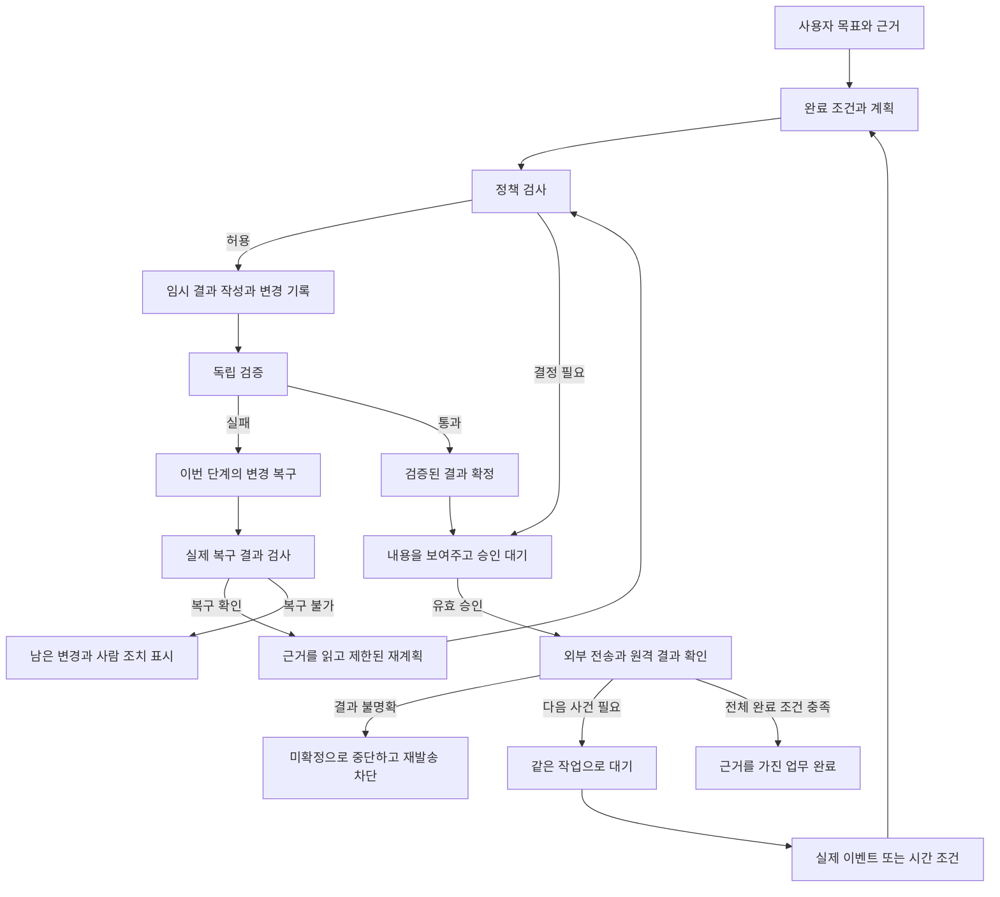

# ActFlow 제품 개편 제안

작성: 2026-10-07, Asia/Seoul. 상태: **전체 제품 개편의 로드맵과 수용 기준**. 다른 제공자·로컬 추론 제거와 2.0 실행본 승격, 교육 파일의 검증·확정·복구는 사용자 요청에 따라 진행했다. [현재 적용 범위](2026-10-07-competition-cleanup.md). 이 문서 전체가 구현 완료됐다는 뜻은 아니다. [대회·현재 코드 분석](2026-10-07-actflow-hackathon-review.md)을 근거로 범위를 정했다.

후속 적용: 교육 명단의 정확한 열·행·원본 값, 회신의 인원·비용, 검증 전 임시 상태와 검증 후 파일 확정, 변경 해시 검사 및 실패 시 임시 파일 복구를 구현했다. 이 파일의 일반화된 Goal Contract·실메일·전체 변경 보상·운영 인증 설계까지 구현된 것으로 읽지 않는다.

10월 11일 후속: 계정 인증, Gmail 어댑터, 원문 인용을 사용하는 완료 조건, 지원 파일 보상·제한 재계획을 구현했다. 실제 지원 범위와 외부 계정 검증의 공백은 [최신 보고서](2026-10-11-release.md)를 따른다.

## 1. 제품의 한 문장

**ActFlow completes work with evidence.**

한국어: **AI가 업무를 실행하고, ActFlow가 결과를 확인하고 복구하며 끝까지 이어갑니다.**

설명: 업무별 완료 조건, 사용자 행동 경계, 독립 검증, 복구 기록을 가진 지속 업무 Agent. 사용자는 도구 호출 로그를 해석하는 대신 ‘무엇이 끝났고, 어떤 근거가 있으며, 어디서 내 판단이 필요한지’를 확인한다.

‘You can actually trust’는 제품 방향으로 좋지만 현재 검증 허점이 있는 빌드의 성능 주장으로 쓰기에는 이르다. 먼저 검증 가능한 결과와 복구 범위를 보여준 후 신뢰를 말한다.

## 2. 대안 비교와 선택

| 접근 | 장점 | 부담 | 판단 |
|---|---|---|---|
| **지속 업무 Agent + 완료 조건·복구 경험** | 기존 2.0 재사용, 사용자 가치와 실패 데모가 연결됨 | 실 모델·독립 검증·실 커넥터 증명 필요 | **추천** |
| Gmail/Calendar/Docs를 넓게 처리하는 개인 비서 | 많은 사람에게 익숙한 사용법 | OAuth·권한·커넥터·상시 실행 범위가 커지고 핵심 증거가 약해짐 | 이번 범위에서 제외 |
| 다른 Agent용 안전 실행 SDK | 개발자 차별점과 재사용성 | SDK 채택 사례·통합·개발자 경험을 새로 증명해야 함 | 이후 확장 후보 |

완료 조건과 정책은 재사용 가능한 내부 모듈로 만들 수 있다. 다만 이번 제출의 사용자에게 SDK 설정이나 데이터베이스 용어를 노출하지 않는다.

## 3. 첫 사용자와 주력 업무

첫 사용자: 소규모 팀에서 교육 신청과 외부 자료 제출을 맡는 운영 담당자.

요청: ‘교육 신청 자료를 정확히 만들고, 승인된 운영팀에 제출한 뒤 접수 상태를 확인해줘.’

현재 직원 샘플, 승인, XLSX/DOCX를 재사용한다. 대상자 2명의 정확한 행, 필요한 열, 원문에 근거한 비용·기한, 외부 전송 제외 항목을 검사한다. 180,000원 비용은 **검토·승인 대상**이며 실제 지출이나 결제 실행이 아니다.

첫 데모의 목적은 범용 계약 체결을 대신하는 것이 아니다. 한 업무에서 정상 완료·오류 탐지·복구·승인·실행·대기를 모두 증명한다. 제품 이후 확장은 협력사 온보딩·반복 보고·자료 제출로 검토한다.

## 4. 새로 추가할 중심: 완료 조건

Goal Contract는 사용자가 이해할 수 있는 완료 조건을 저장한 기록이다. 법적 계약이라는 의미가 아니다.

모델이 초기 조건과 계획을 제안하고, 서버가 입력 근거·지원 도구·사용자 정책을 검사한다. 알 수 없는 수신자나 인원수는 추측하지 않는다. 사용자 결정을 필요로 하는 빈 조건은 한곳에서 명확히 확인받는다.

| 정보 | 역할 |
|---|---|
| owner, taskId, version | 누구의 어떤 업무 조건인지 식별 |
| goal, source IDs와 SHA-256 | 사용자의 목표와 원문 근거 |
| allowed actions, exact recipient, export fields | 허용된 행동·상대·데이터 범위 |
| required results | 필요한 파일·회신·외부 상태 |
| predicates | 프로그램으로 검사할 구조·내용·값·관계 |
| wait condition, due time | 어떤 사건을 언제까지 기다릴지 |
| approval requirements | 필요한 사람의 결정과 결합할 입력 |
| retry limits, execution deadline | 무한 실행과 비용 제한 |

핵심 불변식:

1. **재계획으로 완료 조건을 느슨하게 만들 수 없다.** 원문 변경이나 사용자의 목표 변경은 새 조건 버전으로 기록한다.
2. 모델의 COMPLETE는 제안이다. 필수 조건별 검사와 근거가 충족돼야 실제 완료 상태가 된다.
3. 외부 답장의 ‘접수 완료’가 모호하면 미확정으로 남긴다. 모델의 의미 해석만으로 현실의 등록 완료를 보증하지 않는다.
4. 모든 완료에는 동일 버전의 목표·입력·정책·검증 결과가 연결된다.

첫 명단의 검사 예:

- 시트의 필수 열이 정확히 있고 형식이 맞는다.
- 대상 ID는 E001/E002이며 각 ID가 정확히 한 행에 있다.
- 이름·부서·직책은 원본 조회 결과와 각각 일치한다.
- 비대상 E003은 들어 있지 않다.
- 메모 셀에 이름을 나열한 것은 참가자 행으로 인정하지 않는다.
- 개인 연락처·은행 정보·다른 작업 데이터가 외부 출력에 포함되지 않는다.
- 회신의 대상자 수와 명단의 실제 행 수가 일치한다.
- 회신에 적힌 비용·기한이 원문 근거와 일치한다.

## 5. Policy Boundary

정책은 모델 프롬프트 바깥의 결정적 코드에서 실행한다. 2.0의 정확한 주소, 소유자, 첨부 근거, 외부 전송 검사 경로를 재사용한다.

우선순위: 시스템 금지·조직의 최소 경계 → 명시적으로 저장한 사용자 규칙 → 현재 목표의 범위 → 모델의 제안. 더 높은 경계를 모델·기억·사용자 규칙이 임의로 낮추지 못한다.

| 행동 | 기본 제안 |
|---|---|
| 허용 데이터 조회·새 임시 파일 작성 | 자동 |
| 동일 작업의 검증된 파일 공개·다운로드 | 조건 충족 후 허용 |
| 등록되지 않은 상대·주소 변경·첨부 변경 | 새 확인 또는 차단 |
| 실제 외부 메일 | 첫 제출판에서는 매 전송 명시 승인 |
| 결제·서명·외부 삭제·권한 변경 | 지원하지 않는 행동으로 사람에게 넘김 |

사용자별 경계 기억은 ‘이 주소에는 이런 종류의 자료를 보낼 수 있다’는 좁은 규칙의 저장·조회·철회다. 반복 승인을 했다는 이유만으로 자동 권한을 학습하지 않는다. 신뢰 주소의 자동 발송은 별도 명시 동의와 검증을 갖춘 이후 확장이다.

주소는 표시 이름으로 판단하지 않는다. 정확한 mailbox·Reply-To·실 커넥터가 제공하는 발신 인증 근거를 함께 다룬다. 신뢰한 발신자도 메일 본문으로 조직 권한·다른 프로젝트 접근을 바꿀 수 없다.

승인은 task/goal version, action, recipient, subject/body hash, attachment IDs/hashes, policy version에 결합한다. 승인 후 본문·첨부·수신자·정책이 바뀌면 이전 승인은 재사용하지 않는다. 권한 철회는 전송 직전에 다시 확인한다.

## 6. 실행과 검증의 분리

Executor는 도구 실행 결과와 변경 기록만 반환한다. Verifier는 모델의 설명이 아니라 실제 파일이나 원격 상태를 읽는다.

검증은 세 층으로 나눈다:

1. 존재·형식: 파일 존재, 크기, 정상 파싱, 예상 object ID.
2. 업무 내용: 열·대상 ID·값·중복·제외 항목·문서와 명단의 일관성.
3. 목표: 요청한 모든 결과와 필요한 승인·외부 상태가 갖춰졌는지.

SHA-256은 동일한 파일인지 확인하는 근거다. 내용이 옳다는 증거로 사용하지 않는다. 모델의 자체 평가 역시 독립 검증을 대신하지 못한다.

이번 명단은 원본 구조와 값 대조로 충분하다. 수식 계산이 필요한 새 업무는 별도 계산 엔진과 결과 재계산을 검증해야 한다. 수식 문자열 존재나 cached value만 확인하고 정상 계산을 주장하지 않는다.

외부 메일은 API 성공 직후 원격 message ID로 조회해 수신자·본문·첨부가 실행 의도와 맞는지 확인한다. 전송 요청 접수, 보낸 편지함의 존재, 상대에게 배달, 상대의 접수 확인을 다른 상태로 표시한다. 실제 provider가 증명할 수 없는 배달을 표시하지 않는다.

실 커넥터의 첫 후보는 통제하는 테스트 계정의 Gmail API다. send/get 경로로 전송 결과를 대조하고, 수신 이벤트는 실제 메일함에서 읽은 message/thread ID에 결합한다. 현재 transport 인터페이스에 이 adapter가 이미 있다고 간주하지 않는다. [Google Gmail API](https://developers.google.com/workspace/gmail/api/reference/rest)

OAuth client와 consent, 허용된 테스트 사용자, 필요한 최소 scope, refresh token의 암호화·갱신·철회 처리가 준비 조건이다. External/Testing 설정의 Gmail scope refresh token은 일반적으로 7일 만료 조건을 가진다. 10월 제출 때의 연결 성공으로 12월 심사 기간의 접근을 보장하지 말고 계정 상태와 재인증 경로를 검증한다. [Google OAuth 공식 문서](https://developers.google.com/identity/protocols/oauth2)

Nebius는 OpenAI 호환 API, 도구 호출과 구조화 출력을 제공하지만 모델별 지원이 다르므로 선택한 Nemotron에서 검사한다. JSON mode의 문법 보장과 업무 조건의 충족도 구분한다. [공식 도구 호출](https://docs.tokenfactory.nebius.com/ai-models-inference/function-calling), [공식 구조화 출력](https://docs.tokenfactory.nebius.com/ai-models-inference/json)

## 7. COMMIT / ROLLBACK의 정확한 의미

**여러 외부 서비스의 모든 행동을 하나의 원자적 transaction으로 묶는다고 주장하지 않는다.** 파일·DB·메일 서버는 하나의 데이터베이스가 아니다.

로컬 단계는 새 버전을 임시로 작성하고 검증한 후 공개한다. 실패하면 이번 단계가 만든 변경만 보상한다. 외부 전송은 검증·승인이 끝난 뒤 마지막 경계에서 실행한다. 이미 전송된 메일은 복구 대상에 넣지 않는다.

단계별 변경 기록에는 action ID, task/episode, idempotency key, 입력 해시, 변경 전후 상태, 보상 작업, 원격 ID, 결과 확인 여부가 필요하다.

첫 제출판의 보상 범위:

- 이번 단계가 새로 만든 임시 파일은 실제 삭제 후 부재를 확인한다.
- 새 결과 버전은 임시 영역에서 폐기하고 이전 검증 버전을 보존한다.
- 이미 사용자에게 공개한 이전 결과를 재계획 중 임의로 삭제하지 않는다.
- 자신이 만든 파일도 이후 내용이 바뀌었으면 해시·소유 범위를 검사한다. 사용자 변경을 덮어쓰지 않는다.
- 보상 실패는 남은 경로·변경·시도와 함께 ‘복구 필요’로 표시한다.

외부 효과를 발생시키기 전 쓰기 의도를 저장한다. 실행 후 receipt 저장 전 중단될 수 있으므로, 재시작 때 원격 결과를 먼저 대조한다. 확인할 수 없으면 UNKNOWN이다. idempotency key가 있다고 모든 provider의 exactly-once 전송을 보장하는 것은 아니다.

복구 후 재계획은 입력 목표를 유지하며 검증 실패 근거를 실제 Nemotron에게 전달한다. 무조건 같은 도구를 반복 호출하지 않는다. 최대 2회 재계획 후 사람에게 넘긴다. 기존 2.0의 episode 제한·lease를 함께 유지한다.

## 8. Living Task와 Wake

2.0의 Task, Memory, episode, EventRepository, WakeEngine과 recovery를 기반으로 사용한다. 기존 작업 ID와 원래 목표를 유지하며 새 episode를 만든다.

완료와 대기를 구분한다. 파일 생성 단계가 끝났어도 접수 답장을 기다리면 Task는 완료가 아니다. 다음 사건과 기한이 설정되지 않은 상태를 ‘자동 대기 중’이라고 표시하지 않는다.

worker는 브라우저의 polling이나 첫 HTTP 요청에 기대지 않는다. 지속 가능한 Node worker와 영속 DB를 기본 후보로 검토한다. Next.js 서버의 타이머만으로 모든 배포 환경에서 상시 실행을 약속하지 않는다. 서버리스 배포가 필요하면 지원하는 job·스케줄 경로를 별도로 검증한다.

시연 필수 조건:

- 브라우저를 닫은 동안 실제 worker가 이벤트를 처리한다.
- worker 중단·재시작 후 같은 Task의 상태·대기 조건·이전 결과가 유지된다.
- 같은 event ID의 재전달이 같은 전송을 중복 실행하지 않는다.
- 승인 대기·일시정지 중 들어온 사건은 사라지지 않고 보관된다.
- 취소·완료된 Task는 일반 이벤트로 되살아나지 않는다.
- 지연 도착·잘못된 스레드·다른 소유자의 이벤트는 목표를 바꾸지 못한다.

‘대화창이 닫혀도 계속’과 ‘PC가 꺼져도 계속’은 다르다. 후자는 실제로 켜져 있는 원격 worker를 검증한 경우에만 약속한다.

## 9. Nebius/NVIDIA의 실질적인 역할

기본 제출 경로는 Nebius Token Factory에서 NVIDIA Nemotron을 호출하는 방식이다. [공식 quickstart](https://docs.tokenfactory.nebius.com/quickstart)

모델 역할은 문서·목표로부터 근거가 있는 계획 생성, 새 답장에 대한 다음 계획 생성, 독립 검증 실패를 읽고 계획 수정이다. 정책 승인, 파일 검증, 전송 결과 확정은 결정적 런타임이 담당한다.

먼저 Nemotron 한 모델로 end-to-end를 완성한다. 공식 cookbook의 Super 모델 ID는 후보이며 계정의 실제 /models 목록에서 ID·구조화 출력·제한을 확인해 선택한다. 모델을 하드코딩한 광고 문구로 가용성을 대신하지 않는다. [Nebius 공식 cookbook](https://github.com/nebius/token-factory-cookbook/blob/main/models/nemotron/nemotron3-super-120B.md)

Nano/Super/Ultra 다중 모델 라우팅은 실제 비용·속도·품질 측정 후 추가한다. API 제공자 메타데이터에는 hostingProvider=Nebius, modelPublisher=NVIDIA, 실제 모델 ID와 실제 호출 여부를 기록한다. 현재 실행본의 provider는 nebius이며 실제 호출 근거를 서버에서 추가한다.

실 호출 증거는 request/response ID, 모델 ID, 시간, token usage, 응답·계획 해시로 남긴다. 원문·키를 화면이나 로그에 공개하지 않는다. 다른 제공자로 몰래 fallback해서 필수 기술 사용처럼 표시하지 않는다.

## 10. 화면에서 경험해야 할 것

홈은 목표 입력, 첨부, 간단한 완료 조건과 맡기기 버튼을 보여준다. 모델 공급자·effort·엔드포인트는 고급 설정으로 둔다.

작업 화면의 핵심 영역:

1. 목표와 완료 조건: 충족·미충족·근거 없음 구분.
2. 현재 행동과 이유: 처리 중, 답장 대기, 내 확인 필요, 복구 중, 복구 필요, 완료.
3. 확인이 필요한 행동: 정확한 상대·내용·첨부·효과를 한 카드에 표시.
4. 결과: 통과한 항목과 실제 결과물을 함께 제공.
5. 기록: 오류→복구→재계획→새 실행의 연결을 이해할 수 있게 표시.

불확실한 결과를 녹색 완료로 바꾸지 않는다. ‘검사 안 함’과 ‘검사 실패’를 구분한다. 완료 비율은 정의된 조건의 충족 개수로만 보여주고 모델이 만든 임의 퍼센트를 사용하지 않는다.

한국어 사용 경험은 유지하면서 영어 데모와 테스트 안내를 준비한다. 데모 기본 화면에는 영어를 선택할 수 있게 한다. 그래프와 Flight Recorder는 상세 근거로 유지한다.

## 11. 모듈과 재사용 경계

| 구성 | 재사용할 자산 | 필요한 변경 |
|---|---|---|
| Task/episode | 2.0 tasks·lifecycle·memory | 목표 조건 버전과 전체 완료 판정 연결 |
| Provider | Nebius provider·safe HTTP | 계정 기반 실제 NVIDIA 추론과 재계획 검증 |
| Policy/approval | 기존 정책·주소·outbox guard | 저장·철회 경계와 입력 해시 결합의 누락 여부 검사 |
| Verifier | 기존 파일 파서 | substring 검사에서 명단·문서·전체 목표 검사로 확장 |
| Artifact workspace | 임시/확정 영역 | 검증 전 임시 유지와 변경별 보상 기록 |
| Email | 2.0 transport·outbox·UNKNOWN | 한 개 실제 transport와 조회·대조 기능 |
| Wake | 2.0 event·lease·scheduler·recovery | 브라우저 없는 실행·재시작 E2E·실 사건 연결 |
| UI | 2.0 TaskDashboard/Workspace | 완료 조건·복구 결과·원격 확인 상태를 주 화면에 연결 |

새 영속 데이터는 목표 조건 버전, 단계별 변경 기록, 독립 검사 결과, 결과 근거 연결에 한정한다. 이전 사용자 DB·마스터 키는 보존하고 additive migration 및 백업·복원을 검증한다.

## 12. 구현 완료를 판정할 기준

| ID | 필수 판정 |
|---|---|
| A01 | 기준 소스의 clean install, typecheck, 전체 단위·통합, build, E2E가 성공 |
| A02 | 실제 Nebius/NVIDIA 계획과 검증 오류에 따른 재계획을 앱에서 확인 |
| A03 | 두 이름이 메모에만 있는 반례는 실패, 정상 두 행의 명단은 통과 |
| A04 | 잘못된 대상·열·중복·비대상·민감 필드·문서 인원 불일치를 차단 |
| A05 | 검증 실패 단계는 결과를 공개하지 않고 이번 임시 변경을 복구 |
| A06 | 삭제 실패·변경 충돌·불확실한 외부 전송을 성공으로 표시하지 않음 |
| A07 | 승인 후 수신자·본문·첨부·정책 변경 시 이전 승인 무효 |
| A08 | 실제 메일 결과를 원격 조회하고 확인 범위를 정확히 표시 |
| A09 | 창 종료·worker 재시작 후 같은 Task·조건·근거가 유지 |
| A10 | 중복 이벤트·중복 재개가 외부 행동을 중복 실행하지 않음 |
| A11 | 모든 정상 작업을 승인 또는 HUMAN_ONLY로 돌려놓고 자동화 성공이라고 계산하지 않음 |
| A12 | 영어 피치·실행판·저장소·문서의 기능 주장이 실제 증거와 일치 |

## 13. 검토 후 확정할 사항

추천 방향은 위의 좁은 업무·완료 조건·복구 구조다. 2.0 기반 실행본 승격과 모델 경로 정리는 적용했다. 독립 목표 검증·최소 실제 커넥터·상시 worker 환경은 후속 명세와 검증으로 확정한다. 계정 크레딧·접속, 메일 OAuth 준비, 사용자 관찰 결과는 외부 조건으로 관리한다.

본 제안은 기능을 완성했다고 주장하지 않는다. ‘누가 어떤 결과를 왜 신뢰할 수 있는지’를 코드·결과·복구·실제 사용 증거로 만드는 것이 목표다.
